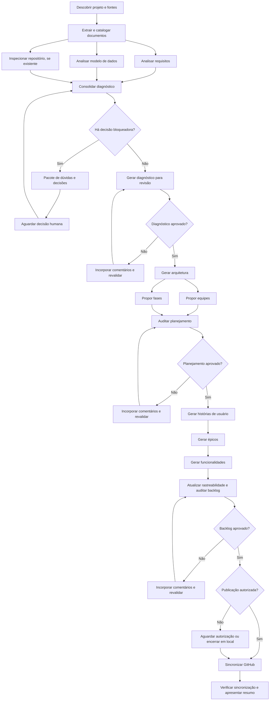

<!-- Conteúdo reorganizado do Manual de Uso do Sammy. Trecho de origem: linhas 1–508. -->

> **Nesta página:** Visão geral, propósito, identidade do Sammy, ativação, princípios, workflow e arquitetura de orquestração.

[← Voltar ao índice da documentação](../README.md)

---

# Manual de uso do Sammy

**Manual operacional e especificação do framework de engenharia com Spec-Driven Development (SDD) no Claude Code**

- **Idioma:** português brasileiro
- **Agente principal:** Sammy, o ponto único de contato com a pessoa usuária
- **Comando explícito de ativação:** `/hora-de-trabalhar` (a chamada “Sammy, hora de trabalhar”)
- **Interface:** comando explícito de ativação `/hora-de-trabalhar`, seguido de conversa em linguagem natural
- **Orquestração:** Sammy + Skills do Claude Code + subagentes especializados
- **Automação determinística:** scripts, validações, Git e GitHub Actions
- **Gestão do trabalho:** GitHub Issues e GitHub Projects
- **Fonte canônica:** documentos Markdown versionados no Git
- **Princípio de operação:** autonomia controlada, execução incremental e aprovação humana nos pontos de decisão

> **Status deste manual:** descreve o comportamento desejado e a implementação de referência do Sammy. Os comandos, agentes, skills, scripts, modelos e integrações só estarão disponíveis depois de instalados no repositório. Não trate exemplos deste manual como evidência de que uma automação já foi executada ou configurada.

## Como usar este manual

Este manual atende a três necessidades diferentes:

1. **Usar Sammy em um projeto:** consulte o início rápido, os comandos, os modos de operação e os exemplos. Na utilização cotidiana, converse com Sammy; não é necessário coordenar diretamente os especialistas.
2. **Entender o processo:** consulte a triagem adaptativa, o ciclo SDD, as regras de aprovação, o backlog, a integração GitHub e os critérios de qualidade.
3. **Instalar, manter ou evoluir o framework:** consulte a arquitetura de agentes e skills, a configuração, os contratos dos scripts e os apêndices com modelos copiáveis.

O corpo principal explica o comportamento esperado e as decisões do processo. Os apêndices fornecem templates e contratos de implementação. **Um template é uma opção disponível, não um formulário obrigatório:** Sammy deve escolher apenas os modelos pertinentes ao trabalho real.

### Início rápido: usar Sammy em um repositório

> Este roteiro pressupõe que o framework já foi instalado no repositório. A instalação é descrita na parte sobre Claude Code e na parte de implantação.

1. Abra o repositório do projeto no terminal e inicie o Claude Code.
2. Configure Sammy como agente padrão do repositório (`"agent": "sammy"` em `.claude/settings.json`) ou inicie a sessão com `claude --agent sammy`.
3. Coloque documentos de entrada em `documentos/entrada/`, caso existam. Não é necessário preparar uma instrução detalhada.
4. Chame Sammy com o comando explícito `/hora-de-trabalhar` — a forma de ativação do framework.
5. Sammy reconhece o repositório, verifica o estado, identifica o trabalho pendente, avalia o contexto e escolhe a próxima ação segura. Em um projeto novo, poderá iniciar a análise e o planejamento; em um projeto existente, poderá retomar, revisar mudanças ou apresentar o estado.
6. Sammy executa o que estiver autorizado e apresenta decisões, riscos, resultados e bloqueios em um pacote consolidado.
7. Revise os artefatos quando ele solicitar aprovação. As aprovações ficam vinculadas às versões dos arquivos.
8. Para começar um novo ciclo de trabalho, invoque novamente `/hora-de-trabalhar`. Os comandos especializados continuam disponíveis para intervenção direta, mas não são necessários no uso normal.

**A ativação não exige que a pessoa descreva previamente o que Sammy deve fazer.** O primeiro trabalho de Sammy é descobrir o estado do projeto e determinar a próxima atividade apropriada. Depois da ativação, a pessoa pode conversar naturalmente, dar novas instruções ou responder às decisões que Sammy apresentar.

## Sumário

- [Início rápido: usar Sammy em um repositório](#inicio-rapido-usar-sammy-em-um-repositorio)
- [Parte I — Visão e funcionamento do framework](#parte-i--visao-e-funcionamento-do-framework)
- [Parte II — Planejamento de produto e engenharia](#parte-ii--planejamento-de-produto-e-engenharia)
- [Parte III — Claude Code: agentes, skills e contexto](#parte-iii--claude-code-agentes-skills-e-contexto)
- [Parte IV — GitHub e automações externas](#parte-iv--github-e-automacoes-externas)
- [Parte V — Implantação, validação e evolução](#parte-v--implantacao-validacao-e-evolucao)
- [Apêndice A — Modelos dos documentos de planejamento](#apendice-a--modelos-dos-documentos-de-planejamento)
- [Apêndice B — Modelos das especificações por funcionalidade](#apendice-b--modelos-das-especificacoes-por-funcionalidade)
- [Apêndice C — Modelos de agentes, skills e regras](#apendice-c--modelos-de-agentes-skills-e-regras)
- [Apêndice D — Modelos de pesquisa, defeitos e mudanças](#apendice-d--modelos-de-pesquisa-defeitos-e-mudancas)
- [Apêndice E — Estados, aprovações e configuração da automação](#apendice-e--estados-aprovacoes-e-configuracao-da-automacao)
- [Apêndice F — Triagem adaptativa e avaliação de execução](#apendice-f--triagem-adaptativa-e-avaliacao-de-execucao)
- [Apêndice G — Gerenciamento adaptativo de modelos, esforço e contexto](#apendice-g--gerenciamento-adaptativo-de-modelos-esforco-e-contexto)
- [Referências](#referencias)

---

## Parte I — Visão e funcionamento do framework

Esta parte apresenta o propósito, os princípios, a experiência de uso e a arquitetura de orquestração. Ao terminar a leitura, deve estar claro o que o framework automatiza, quando ele reduz ou aumenta o rigor e em quais situações precisa interromper para pedir uma decisão.

### Objetivo

Construir um workflow reutilizável no Claude Code que receba documentos de entrada de um projeto — inicialmente um documento de requisitos e um modelo de dados — e transforme essas fontes em um planejamento de produto e engenharia, um backlog rastreável e, posteriormente, especificações individuais para implementação.

O processo deve automatizar a análise, a elaboração dos artefatos, as verificações de consistência e a publicação do backlog no GitHub. As decisões de produto, as decisões arquiteturais relevantes e as aprovações entre etapas continuam sob responsabilidade humana.

O objetivo não é apenas gerar arquivos Markdown. O objetivo é manter uma cadeia de rastreabilidade entre as fontes originais, os requisitos, as histórias de usuário, os épicos, as funcionalidades, as especificações técnicas, as tarefas e o trabalho acompanhado no GitHub.

O framework deve ser o mais automatizado possível. A pessoa ativa **Sammy** por meio de um comando explícito: `/hora-de-trabalhar`. Não precisa explicar a tarefa para que ele comece. Sammy é o agente principal da sessão e, ao ser ativado, reconhece o repositório, examina as fontes, consulta o estado e o manifesto, identifica pendências, avalia o contexto e escolhe a próxima atividade. Em seguida, aciona Skills, delega análises independentes aos subagentes, consolida resultados, valida e corrige problemas mecânicos. A pessoa só é interrompida para decisões que realmente alteram escopo, regras, arquitetura ou risco, ou para autorizar efeitos externos. O estado e o manifesto permitem retomar o processo sem repetir trabalho.

#### Entradas

Os arquivos iniciais ficam em `documentos/entrada/`:

- `requisitos.pdf`: objetivos, necessidades, regras de negócio, atores, requisitos funcionais e não funcionais, restrições e critérios de aceitação, quando disponíveis.
- `modelo-de-dados.pdf` ou `modelo-de-dados.md`: entidades, atributos, relacionamentos, cardinalidades, restrições e demais informações de dados disponíveis.

O processo também pode receber diagramas, glossários, documentos de arquitetura existentes, protótipos e outros materiais. Toda fonte adicional deve ser registrada no diagnóstico.

#### Entregáveis principais

O workflow gera, no mínimo:

```text
plano/
├── diagnostico.md
├── arquitetura.md
├── equipes.md
├── fases.md
├── rastreabilidade.md
└── tarefas/
    ├── historias-de-usuario.md
    ├── epicos.md
    └── funcionalidades.md
```

Para cada funcionalidade aprovada, o processo poderá gerar uma especificação SDD independente em `.ia/especificacoes/`.

### Sammy — agente principal e ponto único de contato

**Sammy é o nome do agente principal do framework.** Ele não é apenas mais um especialista: é o agente que representa o sistema perante a pessoa usuária, mantém a visão geral do projeto e coordena os demais agentes.

A pessoa conversa somente com Sammy no fluxo normal. Os especialistas trabalham em segundo plano, cada um em seu próprio contexto, e devolvem resultados a Sammy. Ele reúne as respostas, identifica divergências, decide quais etapas podem continuar, aciona as Skills necessárias e apresenta uma visão consolidada. Um especialista não deve iniciar uma conversa independente com a pessoa usuária nem solicitar decisões por conta própria; deve devolver a Sammy as dúvidas que exigem intervenção humana.

| Aspecto | Responsabilidade de Sammy |
|---|---|
| Compreensão | Interpretar a intenção da pessoa e identificar o objetivo real da solicitação. |
| Diagnóstico | Consultar o repositório, os documentos, o estado, o manifesto e as decisões anteriores. |
| Planejamento | Escolher o workflow, o nível de rigor, os templates e a ordem das atividades. |
| Delegação | Selecionar os especialistas adequados e dividir o trabalho em tarefas independentes. |
| Coordenação | Evitar escrita concorrente, resolver divergências entre resultados e acompanhar dependências. |
| Qualidade | Acionar auditorias, validadores e ciclos limitados de correção. |
| Governança | Respeitar gates, registrar aprovações e solicitar autorização para efeitos externos. |
| Comunicação | Apresentar apenas o que importa: resultado, decisões, riscos, bloqueios e próximo passo. |

**Como a pessoa utiliza Sammy:**

- Abre o repositório no Claude Code e executa `/hora-de-trabalhar` para ativá-lo.
- Não precisa fornecer uma instrução inicial nem escolher o workflow. Sammy primeiro descobre o estado do projeto e identifica o próximo trabalho apropriado.
- Depois da ativação, pode conversar naturalmente: “Sammy, revise a arquitetura considerando a nova entidade Pagamento”.
- Pode chamar `/hora-de-trabalhar` novamente em outro momento para que Sammy verifique o que mudou e retome o trabalho.
- Pode consultar o estado sem iniciar uma nova execução com `/ver-progresso` ou perguntar: “Sammy, o que falta para concluir o planejamento?”.

**Como Sammy utiliza o Claude Code:**

- É configurado como o agente principal da sessão em `.claude/settings.json`, com `"agent": "sammy"`.
- Também pode ser iniciado explicitamente com `claude --agent sammy`.
- Usa `/hora-de-trabalhar` como Skill de ativação explícita; ela inicia o protocolo de reconhecimento e decisão da próxima atividade.
- Usa Skills de execução, como `/processar-projeto` e `/continuar-projeto`, quando a situação identificada exigir esses procedimentos; a pessoa não precisa escolhê-los no fluxo normal.
- Usa o recurso de subagentes do Claude Code para delegar análises especializadas.
- Recebe os resultados dos subagentes e continua responsável pela consolidação e pela comunicação com a pessoa.

A distinção é importante: **Sammy é o agente principal; `/hora-de-trabalhar` é a Skill de ativação; `/processar-projeto` é uma Skill de processamento amplo; os analistas e especialistas são subagentes.** A ativação não substitui Sammy nem executa cegamente um pipeline fixo: ela coloca Sammy em ação para que ele descubra qual procedimento deve conduzir. A pessoa não precisa coordenar diretamente os especialistas.

Sammy deve ter autonomia para escolher procedimentos e executar trabalho local seguro, mas não para inventar regras de negócio, aprovar os próprios artefatos, aceitar riscos relevantes ou realizar publicações remotas sem autorização válida. Ele coordena o processo; não elimina a responsabilidade humana pelas decisões.

### Ativação explícita: `/hora-de-trabalhar`

A experiência deve lembrar a chamada de um assistente pessoal: a pessoa não precisa formular uma tarefa detalhada para colocá-lo em ação. Ela abre o repositório no Claude Code e chama Sammy com um comando curto e inequívoco:

```text
/hora-de-trabalhar
```

A frase que representa a experiência é **“Sammy, hora de trabalhar.”** No Claude Code, sua forma operacional determinística é a Skill `/hora-de-trabalhar`. O comando não recebe argumentos obrigatórios. A pessoa não precisa dizer “analise este projeto”, “continue o planejamento” ou escolher uma etapa antes que Sammy comece.

Ao ser ativado, Sammy executa um protocolo de reconhecimento:

1. **Reconhecer o ambiente:** identificar a raiz do repositório, branch, estado do Git, arquivos relevantes e configurações do framework, sem ler arquivos secretos ou ignorar regras de segurança.
2. **Reconhecer o projeto:** consultar documentos de entrada, contexto permanente, decisões, manifesto, grafo de dependências, aprovações, tarefas e integrações configuradas.
3. **Identificar o estado do trabalho:** determinar se o projeto é novo, se há uma execução interrompida, se existem alterações recentes, se há aprovações pendentes ou se não há trabalho conhecido.
4. **Avaliar o contexto:** executar a triagem adaptativa de porte, rigor, autonomia e granularidade, usando evidências e registrando incertezas.
5. **Escolher a próxima ação:** selecionar a Skill e os especialistas necessários; não executar um pipeline completo se a situação exigir apenas uma mudança pequena ou uma consulta de estado.
6. **Executar o que estiver autorizado:** avançar tarefas locais e independentes, validar resultados e respeitar gates e permissões.
7. **Apresentar o resultado:** informar o que encontrou, o que fez, o que está bloqueado e qual decisão ou autorização é necessária.

Se não houver documentos, pendências ou objetivo inferível com segurança, Sammy não deve inventar trabalho. Depois de inspecionar o ambiente, ele apresenta um resumo do estado e pergunta qual objetivo a pessoa deseja iniciar. Se houver bloqueio em uma parte do fluxo, continua as atividades independentes.

A ativação é repetível e idempotente: chamar `/hora-de-trabalhar` novamente deve fazer Sammy verificar o que mudou e retomar o trabalho apropriado, sem duplicar artefatos ou operações. A Skill de ativação deve conter `disable-model-invocation: true`, para que ela seja iniciada explicitamente pela pessoa e não disparada automaticamente por uma interpretação do modelo.

**Limite da experiência:** `/hora-de-trabalhar` é um comando explícito dentro do Claude Code, não uma palavra de ativação de microfone que fica ouvindo em segundo plano. Uma ativação por voz sempre disponível exigiria um componente externo, fora do escopo deste framework.

### Princípios do processo

O framework segue os princípios de SDD apresentados por Felipe Fontoura em *Spec-Driven Development: Shipping Production Software with AI Agents* (2026), com adaptações para o fluxo de planejamento proposto aqui.

1. **A especificação é a referência do trabalho.** O código deve ser consequência de requisitos e decisões aprovados, não de um prompt isolado.
2. **A intenção precisa ser explícita.** O agente não deve completar lacunas importantes inventando regras de negócio, políticas, tecnologias ou decisões.
3. **Contexto permanente é separado do trabalho de cada funcionalidade.** Regras gerais do produto ficam em `.ia/contexto/`; requisitos e decisões particulares ficam na pasta da funcionalidade.
4. **Cada etapa tem um contrato de entrada e saída.** O documento seguinte deve consumir os artefatos anteriores e manter suas referências.
5. **Aprovação humana é um gate real.** Arquivo existente ou aparentemente completo não significa que foi aprovado.
6. **A rastreabilidade é contínua.** Cada requisito relevante deve ser conectado a histórias, épicos, funcionalidades, decisões e verificações aplicáveis.
7. **A revisão deve ser independente.** O agente que produziu um artefato não deve ser o único responsável por declarar sua qualidade.
8. **Verificação exige evidência.** Uma tarefa não é concluída apenas porque o agente afirma que terminou; é necessário registrar comandos, resultados e limitações.
9. **O rigor deve ser proporcional ao risco.** Não é necessário criar documentação excessiva para mudanças triviais, mas este workflow é destinado a projetos que justificam planejamento estruturado.
10. **Os documentos são vivos.** Quando uma descoberta posterior exigir uma alteração, o agente deve propor a atualização dos artefatos afetados e solicitar a aprovação necessária.
11. **As especificações globais e específicas precisam permanecer alinhadas.** Cada entrega pode revelar decisões duradouras; Sammy deve identificar o que merece ser consolidado no contexto do projeto, sem copiar detalhes temporários ou duplicar conteúdo.

#### O que vem do livro e o que é adaptação

Do livro são adotados principalmente:

- O pipeline IDEA, PLAN, REQUIREMENTS, DESIGN, TASKS, IMPLEMENTATION e REVIEW.
- A separação entre contexto global do projeto e especificações por funcionalidade.
- O uso de identificadores estáveis para rastreabilidade.
- A aprovação explícita entre requisitos, desenho e tarefas.
- A separação de papéis entre arquitetura, implementação e revisão.
- A verificação com evidências atuais.
- A ideia de que o quadro de gestão reflete o estado dos artefatos, mas não os substitui.

São adaptações deste framework:

- Receber inicialmente um PDF de requisitos e um modelo de dados.
- Criar um diagnóstico intermediário antes do planejamento.
- Gerar arquitetura, equipes e fases como documentos de planejamento do projeto.
- Gerar histórias de usuário antes de agrupá-las em épicos e decompor esses épicos em funcionalidades.
- Integrar o backlog ao GitHub Projects.
- Utilizar nomes de arquivos, comandos, agentes, campos e mensagens em português.


Também foram avaliadas ideias do repositório [AgileSpec](https://github.com/mtov/AgileSpec), uma proposta de fluxo ágil para entrega de software assistida por agentes. Ele complementa o livro-base em um ponto diferente: como manter alinhadas as especificações gerais do projeto e as especificações de cada história durante a evolução do código.

Dessa referência, este framework adapta:

- A separação entre especificações globais do projeto e especificações específicas de uma unidade de entrega.
- O ciclo de alinhamento: contexto global orienta a história; decisões úteis descobertas na história retornam ao contexto global.
- A separação dos critérios de aceitação dos detalhes de implementação.
- A organização explícita de cenários normais e casos extremos.
- Arquivos específicos de interface e alterações de dados somente quando a história realmente os exigir.
- Uma etapa de consolidação após implementação e revisão, antes de considerar a entrega concluída.

A adaptação mantém os gates, a rastreabilidade por IDs, o planejamento de tarefas e a evidência de verificação do método-base. O AgileSpec declara seu próprio material como uma proposta preliminar; portanto, ele é tratado como referência de projeto e não como padrão universal ou processo validado para todos os contextos. Consulte a avaliação detalhada na seção sobre alinhamento das especificações e nas referências.
### Modelo de decisão: adaptar o processo ao trabalho real

Sammy não deve classificar um projeto com uma única etiqueta e aplicar a mesma receita a todas as mudanças. Ele deve avaliar separadamente quatro dimensões e manter uma visão do tipo de trabalho em andamento.

| Dimensão | Pergunta respondida | Valores possíveis | O que altera |
|---|---|---|---|
| **Porte** | Qual é a amplitude do sistema e da coordenação necessária? | Pequeno, médio, grande | Profundidade do planejamento global, organização por domínios/equipes e horizonte de entrega |
| **Rigor** | Quanto controle é necessário para reduzir o custo de erro? | Leve, padrão, rigoroso | Profundidade da especificação, quantidade de verificações, evidências e revisões |
| **Autonomia** | Que ações Sammy pode realizar sem nova autorização? | Somente rascunhos, autonomia controlada, autonomia ampliada | Limites de edição, execução local e efeitos externos |
| **Granularidade** | Qual é a menor unidade adequada para planejar e verificar o trabalho? | Projeto, domínio/épico, funcionalidade, história/tarefa | Nível de decomposição, arquivos produzidos e tamanho das entregas |

O **tipo de trabalho** é registrado separadamente: projeto novo, evolução de projeto existente, modernização, correção de defeito, pesquisa técnica, migração, refatoração ou alteração pontual. O tipo determina quais análises são relevantes; não substitui as quatro dimensões.

#### Porte não é rigor

Um projeto pode ser pequeno e crítico, grande e de baixo risco em determinada mudança, ou médio e muito incerto. Porte descreve amplitude; rigor descreve os controles exigidos. “Crítico” é uma condição de risco, não um tamanho de projeto.

| Porte | Sinais típicos | Planejamento adequado |
|---|---|---|
| **Pequeno** | Um domínio delimitado, poucos fluxos, uma equipe, poucas integrações e poucas dependências | Diagnóstico enxuto, backlog curto, fases ou marcos simples; não criar RACI, sprints ou múltiplos épicos sem necessidade |
| **Médio** | Vários módulos relacionados, integrações relevantes, diversas jornadas ou mais de uma frente de trabalho | Arquitetura, fases, equipes/responsabilidades, backlog rastreável e dependências explícitas |
| **Grande** | Muitos domínios, sistemas ou equipes, integrações numerosas, dependências cruzadas e implantação coordenada | Fronteiras de domínio, contratos, governança de mudanças, plano de integração, riscos e estratégia de entrega por etapas |

O porte deve ser estimado por evidências do escopo e da estrutura, não pelo número bruto de requisitos ou histórias. Um documento longo não torna um sistema grande; um sistema pequeno com regras críticas não se torna leve.

#### Níveis de rigor

| Nível | Quando usar | Comportamento mínimo |
|---|---|---|
| **Leve** | Mudança pequena, isolada, reversível e de baixo risco | Entender o contexto afetado, registrar resultado esperado, executar verificação pertinente e documentar somente o necessário |
| **Padrão** | Nova funcionalidade ou mudança com várias regras, dependências ou impacto relevante | Requisitos claros, critérios verificáveis, desenho técnico proporcional, tarefas independentes, rastreabilidade e revisão |
| **Rigoroso** | Dinheiro, segurança sensível, dados críticos, regulação, migração, alta disponibilidade ou alto custo de falha | Análise de risco, decisões explícitas, cenários negativos, estratégia de recuperação, validação aprofundada, evidências e revisão independente |

Os limites numéricos e condições de elevação são aplicados pelo motor de políticas descrito na seção “Triagem inteligente”. A pontuação é uma heurística de seleção de processo, não uma certificação de segurança nem uma medida científica de risco.

#### Níveis de autonomia

| Modo | Sammy pode fazer | Sammy não pode fazer sem autorização adicional |
|---|---|---|
| **Somente rascunhos** | Ler, analisar e criar rascunhos locais em áreas autorizadas | Alterar código existente, aprovar documentos, publicar, criar recursos remotos ou executar operações destrutivas |
| **Autonomia controlada** | Criar e atualizar artefatos locais, executar verificações e corrigir problemas mecânicos reversíveis | Aprovar gates, aceitar riscos, publicar remotamente sem autorização persistente, apagar ou alterar dados externos |
| **Autonomia ampliada** | Executar tarefas locais aprovadas e operações remotas previamente autorizadas por escopo e destino | Ignorar gates, ampliar a própria autorização, executar ações destrutivas não previstas ou decidir regras de negócio |

A autonomia não reduz o rigor. Mesmo no modo ampliado, gates de aprovação, controles de segurança e limites de efeitos externos continuam válidos.

#### Granularidade

Sammy deve escolher a menor unidade que continue entregando valor compreensível e possa ser validada de forma independente:

- **Projeto:** quando a solicitação exige estabelecer ou revisar a visão global, arquitetura, equipes, fases e backlog.
- **Domínio ou épico:** quando a mudança atravessa várias funcionalidades relacionadas.
- **Funcionalidade:** unidade padrão para especificação SDD e acompanhamento de entrega.
- **História ou tarefa:** para trabalho delimitado, correções e execução incremental.

Não dividir apenas para produzir mais cartões ou documentos. Se duas partes não podem ser verificadas ou entregues separadamente, Sammy deve reconsiderar a divisão. Se uma unidade não cabe em uma entrega controlável, deve decompô-la.

#### Regras de precedência

1. Controles globais aprovados no projeto continuam obrigatórios para toda mudança à qual se aplicam.
2. O rigor local é avaliado para cada funcionalidade, história ou mudança; pode ser menor que o rigor usado no planejamento global, desde que não remova controles globais.
3. Uma condição crítica local eleva imediatamente o rigor daquela unidade e dos artefatos dependentes.
4. Informação desconhecida nunca é interpretada como risco baixo.
5. A autonomia determina o que pode ser executado; não autoriza aprovação de decisões humanas.
6. O perfil escolhido é registrado junto das evidências, justificativas e versão das fontes.

#### Projeto novo, projeto existente e modernização

**Projeto novo (greenfield):** tratar os documentos recebidos como fontes de intenção; identificar decisões ainda não tomadas; distinguir proposta de decisão aprovada; não assumir stack ausente.

**Projeto existente (brownfield):** inspecionar código, configuração, testes, migrações e documentação; separar comportamento observado de intenção; não assumir que o legado está correto; evitar reescrita total sem comparação de alternativas.

**Modernização ou migração:** inventariar dependências, dados e integrações; definir coexistência, migração, reconciliação, reversão e desativação; não considerar a migração concluída apenas porque o novo sistema compila.

#### Qualidade e disponibilidade das fontes

| Caso | Conduta de Sammy | O que não fazer |
|---|---|---|
| Fontes completas e coerentes | Cruzar fontes, registrar cobertura e seguir | Reescrever silenciosamente os originais |
| Requisitos vagos | Extrair o explícito e registrar ambiguidades | Transformar adjetivos em metas inventadas |
| Modelo de dados sem requisitos correspondentes | Apontar elementos sem justificativa de negócio | Criar funcionalidades só porque existe uma tabela |
| Requisitos sem modelo de dados | Registrar necessidade de modelagem como pendência | Inventar tabelas como se estivessem aprovadas |
| Fontes contraditórias | Criar achado com referências e impactos; solicitar decisão | Escolher uma fonte por preferência |
| PDF com extração ruim | Identificar páginas ilegíveis e pedir fonte melhor ou revisão | Declarar cobertura integral sem evidência |
| Modelo possivelmente desatualizado | Comparar com migrações e repositório, se disponíveis | Tratar o diagrama como schema atual sem confirmação |
| Documento ausente | Continuar partes independentes e explicitar limites | Simular que recebeu a fonte |

Cada fato extraído deve guardar arquivo, página e seção quando possível. Inferências, recomendações, premissas e dúvidas devem ser identificadas como tais.

#### Requisitos conflitantes e planejamento de sprints

Quando houver conflito, Sammy deve registrar as fontes, descrever impactos, apresentar alternativas e solicitar decisão do responsável pelo domínio. Não escolher automaticamente a fonte mais recente sem regra formal de precedência.

Sammy pode propor fases e sequência de entrega sem dados de capacidade, mas não deve assumir compromissos de sprint, datas ou estimativas de equipe sem cadência, disponibilidade, prioridades, dependências e estimativas validadas. Fase, marco e sprint são conceitos diferentes.

### Visão geral do workflow

O processo é dividido em cinco grandes ciclos.

```text
DOCUMENTOS DE ENTRADA
requisitos.pdf + modelo-de-dados.pdf
             |
             v
1. ANÁLISE DOS DOCUMENTOS
extração, interpretação, fontes, lacunas e contradições
             |
             v
GATE 1 — APROVAÇÃO DO DIAGNÓSTICO
             |
             v
2. PLANEJAMENTO DO PROJETO
arquitetura.md + equipes.md + fases.md
             |
             v
GATE 2 — APROVAÇÃO DO PLANEJAMENTO
             |
             v
3. GERAÇÃO DO BACKLOG
historias-de-usuario.md
             |
             v
epicos.md
             |
             v
funcionalidades.md
             |
             v
GATE 3 — APROVAÇÃO DO BACKLOG
             |
             v
4. PUBLICAÇÃO E SINCRONIZAÇÃO
GitHub Issues + labels + relações + GitHub Projects
             |
             v
5. SDD POR FUNCIONALIDADE/HISTÓRIA
requisitos -> critérios -> desenho -> tarefas -> implementação -> revisão
             |
             v
6. CONSOLIDAÇÃO
atualizar contexto global com decisões reutilizáveis e preparar a próxima entrega
```

#### Etapas e responsabilidades

| Etapa | Responsável principal | Entrada | Saída | Aprovação |
|---|---|---|---|---|
| Análise dos documentos | Analista de documentos e analista de dados | PDFs e demais fontes | `diagnostico.md` | Humana |
| Arquitetura | Arquiteto de software | Diagnóstico aprovado e contexto do produto | `arquitetura.md` | Humana |
| Equipes | Planejador de entregas | Arquitetura e diagnóstico | `equipes.md` | Humana, junto ao planejamento |
| Fases | Planejador de entregas | Arquitetura, equipes e dependências | `fases.md` | Humana, junto ao planejamento |
| Histórias | Analista de produto | Requisitos e diagnóstico aprovados | `historias-de-usuario.md` | Humana, junto ao backlog |
| Épicos | Especialista em backlog | Histórias aprovadas em rascunho | `epicos.md` | Humana, junto ao backlog |
| Funcionalidades | Especialista em backlog | Épicos, histórias e arquitetura | `funcionalidades.md` | Humana, junto ao backlog |
| Auditoria | Auditor de planejamento | Todos os artefatos | Relatório de validação | Não aprova; aponta achados |
| Publicação | Publicador do GitHub | Backlog aprovado | Issues e Project | Confirmação antes de criar/alterar itens |
| Implementação | Implementador | Especificação e tarefas aprovadas | Código e testes | Conforme revisão |
| Revisão | Revisor | Especificação, tarefas e código | `revisao.md` e evidências | Humana quando aplicável |
### Princípio de operação: automatizar o trabalho, não a responsabilidade

O framework deve buscar o maior nível de automação compatível com rastreabilidade, segurança e qualidade. Isso significa reduzir a quantidade de comandos, perguntas e operações manuais sem transformar o agente em autoridade para decidir sozinho questões de produto, risco ou negócio.

#### Experiência desejada

O fluxo principal deve começar com um comando explícito de ativação:

```text
/hora-de-trabalhar
```

A pessoa não precisa informar argumentos nem descrever o objetivo antes da ativação. Com o repositório aberto, Sammy deve primeiro reconhecer o ambiente e então decidir se precisa processar um projeto novo, continuar uma execução, avaliar uma mudança ou apenas apresentar o estado. Quando a situação exigir planejamento amplo e os documentos estiverem disponíveis em `documentos/entrada/`, Sammy aciona o procedimento `/processar-projeto`, que deve:

1. Detectar o repositório, as fontes, os documentos já existentes e o estado atual.
2. Identificar se é um projeto novo, existente, uma modernização ou uma evolução de produto.
3. Extrair e analisar os documentos, preservando as referências às fontes.
4. Avaliar qualidade, completude, risco, tamanho e incerteza.
5. Selecionar automaticamente o nível de rigor e os templates aplicáveis.
6. Produzir em rascunho o diagnóstico, arquitetura, equipes, fases, histórias, épicos, funcionalidades e rastreabilidade.
7. Delegar análises independentes em paralelo quando não houver dependência entre elas.
8. Executar validadores determinísticos e auditorias semânticas.
9. Corrigir automaticamente problemas mecânicos e estruturais permitidos.
10. Repetir a validação até passar ou atingir o limite de tentativas configurado.
11. Preparar um pacote único de revisão, com decisões, dúvidas bloqueadoras, riscos e diffs.
12. Aguardar somente as decisões humanas realmente necessárias.
13. Após aprovação e autorização de integração previamente configurada, publicar e sincronizar o backlog no GitHub.
14. Registrar o estado, os hashes das fontes, a execução e a próxima etapa segura.

A pessoa não deve precisar chamar `/analisar-documentos`, depois `/planejar-projeto`, depois `/montar-backlog` e depois `/validar-planejamento` no uso normal. Também não deve precisar decidir se `/processar-projeto` é o procedimento correto: Sammy escolhe isso após a ativação. Esses comandos continuam disponíveis para execução isolada, correção parcial, diagnóstico ou depuração.

#### Comandos principais revisados

| Comando | Papel | Quando usar |
|---|---|---|
| `/hora-de-trabalhar` | **Ativação explícita de Sammy.** Reconhece o ambiente, consulta o estado e escolhe a próxima atividade sem briefing inicial. | Ao começar uma sessão de trabalho |
| `/processar-projeto` | Procedimento amplo de planejamento e backlog, acionado por Sammy quando necessário ou diretamente como intervenção. | Projeto novo ou replanejamento abrangente |
| `/continuar-projeto` | Retoma da próxima etapa segura | Recuperação explícita de uma execução interrompida |
| `/ver-progresso` | Consulta o estado sem alterar artefatos | A qualquer momento |
| `/reprocessar-projeto` | Recalcula apenas etapas afetadas pelas mudanças | Quando uma fonte ou decisão mudou |
| `/publicar-no-github` | Executa ou retoma a publicação autorizada | Quando o backlog estiver aprovado |

Os demais comandos especializados permanecem como ferramentas de intervenção que Sammy também pode acionar internamente quando apropriado. No uso cotidiano, basta conhecer Sammy e o comando de ativação `/hora-de-trabalhar`; os demais comandos são atalhos opcionais para consulta, retomada ou intervenção direta.

#### Modos de operação

O framework deve oferecer três modos, configuráveis no arquivo `configuracao-do-workflow.json`:

| Modo | Comportamento | Uso recomendado |
|---|---|---|
| `assistido` | O agente prepara cada etapa e solicita confirmação com maior frequência | Projetos novos, alto risco ou processo ainda em calibração |
| `autonomia-controlada` | O agente executa etapas locais, análises, rascunhos, validações e correções mecânicas; interrompe nos gates humanos e em ações externas | **Padrão recomendado** |
| `somente-rascunhos` | Gera documentos e relatórios, sem aprovações, publicação remota ou alterações externas | Estudos, propostas e projetos exploratórios |

A configuração de modo não pode remover os gates obrigatórios nem conceder poderes que a pessoa não autorizou.
### Arquitetura de orquestração

O framework deve ser organizado em quatro camadas que se complementam:

| Camada | Responsabilidade | Mecanismo |
|---|---|---|
| Agente principal | Decide a próxima etapa, conversa com a pessoa, delega especialistas e consolida resultados | Sammy, executado como agente principal da sessão do Claude Code |
| Ativação e processos reutilizáveis | A ativação reconhece o estado; as demais Skills executam procedimentos específicos com pré-condições e saídas definidas | `/hora-de-trabalhar`, `/processar-projeto` e `/continuar-projeto`, coordenadas por Sammy |
| Inteligência | Interpreta fontes, propõe modelos, identifica riscos e toma decisões técnicas preliminares | Subagentes especializados |
| Execução determinística | Extrai arquivos, compara hashes, verifica IDs, calcula dependências, valida schemas e sincroniza APIs | Scripts Python/CLI |
| Eventos e controles | Executa verificações automáticas em momentos definidos e bloqueia ações não autorizadas | Hooks do Claude Code, GitHub Actions e permissões |

#### Grafo de dependências do pipeline

As etapas devem ser tratadas como um grafo de dependências, e não como uma sequência fixa em que tudo precisa terminar para outra coisa começar.



A execução paralela só deve ocorrer entre tarefas sem dependência de conteúdo. A análise de requisitos, a análise do modelo de dados e a inspeção do repositório podem ocorrer em paralelo; a consolidação depende das três. Depois da aprovação do diagnóstico, a arquitetura é elaborada; a proposta de equipes e a proposta de fases podem ser preparadas em paralelo a partir da arquitetura. Após a aprovação do planejamento, as histórias são geradas, agrupadas em épicos e decompostas em funcionalidades. Essa ordem mantém os gates do processo e evita que o backlog dependa de uma arquitetura ainda não validada.

#### Política de paralelismo

- Executar em paralelo apenas trabalhos independentes e com contratos de saída claros.
- Não permitir que dois agentes editem simultaneamente o mesmo arquivo.
- Agentes especialistas devem devolver resultados intermediários estruturados; Sammy, na sessão principal, consolida os documentos finais.
- Usar subagentes para análise isolada, auditoria, pesquisa ou geração especializada.
- Não criar um agente para cada arquivo. Criar agentes por especialidade e responsabilidade.
- Usar equipes de agentes coordenadas apenas quando houver múltiplas frentes de trabalho longas e realmente independentes. Para a primeira versão, subagentes são suficientes.
- Definir limite de agentes simultâneos por configuração, para controlar custo, latência e conflitos.
- Registrar agente utilizado, entradas, saídas, arquivos alterados e resultado da execução.

#### Não confundir skill, agente, hook e script

| Mecanismo | Deve ser usado para | Não deve ser usado para |
|---|---|---|
| Skill | Orquestrar um procedimento reutilizável | Repetir instruções globais ou substituir validações determinísticas |
| Subagente | Executar uma análise ou tarefa especializada em contexto isolado | Aprovar o próprio resultado ou editar arquivos concorrentes |
| Hook | Reagir deterministicamente a eventos do Claude Code | Tomar decisões de negócio complexas |
| Script | Executar operações previsíveis, testáveis e repetíveis | Interpretar ambiguidades semânticas de requisitos |
| GitHub Actions | Validar PRs e refletir estados aprovados em eventos do Git | Aprovar especificações por conta própria |
| GitHub Projects | Expor o estado operacional do trabalho | Ser a única fonte de requisitos ou decisões |

A documentação da Anthropic diferencia esses mecanismos: Skills padronizam procedimentos, subagentes isolam tarefas especializadas e hooks executam lógica em eventos específicos do ciclo de vida. Hooks são particularmente úteis quando uma ação precisa acontecer sempre, de modo determinístico. Referências atuais: [Skills](https://code.claude.com/docs/en/skills), [Subagents](https://code.claude.com/docs/en/sub-agents), [Hooks](https://code.claude.com/docs/en/hooks) e [artigo sobre a escolha entre mecanismos](https://claude.com/resources/articles/steering-claude-code-skills-hooks-rules-subagents-and-more).
